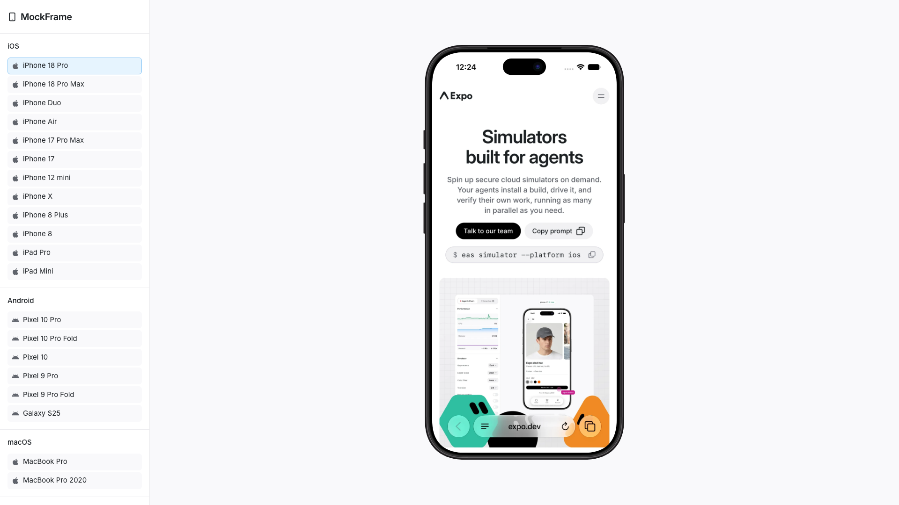

# Device Frames

`@krystofs/device-frames`: device mockups for React (the `MockFrame` component). Showcase your apps in realistic phone, tablet, and laptop frames. Perfect for SaaS landing pages, product demos, and marketing websites.

[](http://typescriptlang.org/)
[](https://opensource.org/licenses/MIT)

<p>
  
</p>

## About this fork

This fork of [mbdev3/react-mockframe](https://github.com/mbdev3/react-mockframe) (1.3.0) makes the Apple and
Google frames follow the real screen and body shapes and adds more devices. It is published on npm as
`@krystofs/device-frames`; the API is the same as react-mockframe's, so switching only changes the import paths.

- **Superellipse screens.** The screen corners of the Apple frames are superellipses (`|x|^n + |y|^n = 1`),
  fitted to Apple's product bezels, not circles. Each fit is within 0.7 PNG px of Apple's screen edge. This
  applies to the iPhone X, 12 mini, 17, 17 Pro Max, 18 Pro, 18 Pro Max, Air, iPad Pro and both iPhone Duo
  displays. The shape is a CSS mask on the screen, so it scales with the frame.
- **Superellipse bodies.** Apple's outer body is the screen curve moved outward by the black border (within
  0.13–0.41 pt RMS on Apple's bezels). On the band frames (iPhone 12 mini, 17, 17 Pro Max, 18 Pro, 18 Pro Max,
  Air, Duo and iPad Pro), the body, glass glow and band rings are now drawn as layers masked to these offset
  curves. The black border keeps one width around the corner: on the iPhone 18 Pro it changes by 0.11 pt,
  before 1.47 pt with a circular body around a superellipse screen. The CSS-only frames keep the circular body
  as a fallback.
- **Exportable.** The masks are self-contained data URIs with no `url(#id)` references, so image exporters such
  as html-to-image render the superellipse screens, bodies and bands.
- **New Apple frames**, measured from Apple's bezels: iPhone 17 Pro Max, iPhone 18 Pro Max, iPhone Air and
  iPhone 12 mini.
- **New Google frames**: Pixel 9 Pro, Pixel 10 Pro, Pixel 9 Pro Fold and Pixel 10 Pro Fold (closed and open
  poses). Screen sizes come from Google's display resolutions and densities (Chrome DevTools for the Pixel 9
  Pro and 10); buttons and hinge marks are measured on Google's renders, and the frame colours are Google
  Store swatches.
- **Pixel frames measured on Google's emulator skins.** The Pixel 10, 10 Pro, 9 Pro, 9 Pro Fold and 10 Pro
  Fold take their bezels, metal band, punch-hole, screen corners and body corners from the emulator skins in
  Android Studio (`device-art-resources`). The screens and bodies are superellipses fitted to the skins
  (within 1.1 px on the screen masks, 1 px on the body outlines); the Pixel 10 family's screens are circles
  (n = 2), as Google's masks are. Like the Apple band frames, the body and band are drawn as masked layers,
  so the band keeps its width around the corners. A closed Fold has different corners on its hinge side:
  small ones on the 9 Pro Fold, and on the 10 Pro Fold a spine beside the body that is shorter than it. The
  band follows each model's finish in Google's specs: polished on the Pixel 9 Pro and 10 Pro, satin
  aluminium on the Pixel 10 and both Folds.
- **Demo site**: a full-screen playground with the device in the middle and a sidebar with all frames, listed
  by platform (iOS, Android, macOS), device options (colour, fold pose, orientation, notch, scale), a
  screenshot upload (an expo.dev screenshot shows until you upload one), export to PNG or WebP, and the code
  snippet.
- **Reference frames**: the playground can show a bezel image next to the generated frame or on top of it,
  at the same screen size, to compare them. The images are not in the repository: copy your own Apple bezel
  PNGs or Android Studio emulator skins into `src/website/reference-frames/` (git-ignored). Its
  [README](src/website/reference-frames/README.md) has the naming scheme.

## Features

- **20 Devices** - iPhone 8/8 Plus, iPhone X, iPhone 12 mini, iPhone 17, iPhone 17 Pro Max, iPhone 18 Pro, iPhone 18 Pro Max, iPhone Air, iPhone Duo (foldable), Pixel 10, Pixel 10 Pro, Pixel 9 Pro, Pixel 10 Pro Fold and Pixel 9 Pro Fold (foldables), Galaxy S25, iPad Mini, iPad Pro, MacBook Pro 2020, MacBook Pro
- **Measured, Not Eyeballed** - iPhone 12 mini, 17, 17 Pro Max, 18 Pro, 18 Pro Max, Air, Duo, iPad Pro and MacBook Pro frames are measured from Apple's official product bezels (99.8% shape match): real screen sizes, corner radii, bezels, Dynamic Island, notch and button positions, with frame colours sampled per finish
- **Real Screen Shapes** - Apple-frame screens use superellipse corners fitted to the bezels, not a circular `border-radius`. On the iPhone 12 mini, 17, 18 Pro, 17 Pro Max, 18 Pro Max, Air, Duo and the iPad Pro, the body and band follow the screen corner too, so the black border has one width all around
- **Multiple Color Variants** - Authentic device colors for each model
- **Landscape Mode** - Rotate phones and tablets
- **Notch/Dynamic Island Toggle** - Show or hide notches
- **Smooth Animations** - Optional animated transitions
- **Custom Device Frames** - Create your own frames with `CustomMockFrame`
- **Modular CSS** - Import only the device families you need
- **TypeScript First** - Full type safety with discriminated unions
- **Lightweight** - ~21KB ESM (~5.7KB gzipped), tree-shakeable

## Supported Devices

| Device | Colors | Landscape | Notch/Island |
|--------|--------|-----------|--------------|
| iPhone X | - | Yes | Notch |
| iPhone 8 | black, silver, gold | Yes | - |
| iPhone 8 Plus | black, silver, gold | Yes | - |
| iPhone 12 mini | white | - | Notch |
| iPhone 17 | black, white, mist-blue, sage, lavender, cosmic-orange, deep-blue | Yes | Dynamic Island |
| iPhone 17 Pro Max | silver, cosmic-orange, deep-blue | Yes | Dynamic Island |
| iPhone 18 Pro | black, silver, glacier, burgundy, gold, natural-titanium | Yes | Dynamic Island |
| iPhone 18 Pro Max | black, silver, glacier, burgundy | Yes | Dynamic Island |
| iPhone Air | space-black, cloud-white, light-gold, sky-blue | Yes | Dynamic Island |
| iPhone Duo | night-sky, star-white | Yes | Camera (3 fold poses) |
| Pixel 10 | obsidian, frost, indigo, lemongrass | Yes | - |
| Pixel 10 Pro | obsidian, porcelain, moonstone, jade | Yes | - |
| Pixel 9 Pro | obsidian, porcelain, hazel, rose-quartz | Yes | - |
| Pixel 10 Pro Fold | moonstone, jade | Yes | - (2 fold poses) |
| Pixel 9 Pro Fold | obsidian, porcelain | Yes | - (2 fold poses) |
| Galaxy S25 | blue-black, icy-blue, navy, mint, silver-shadow, coral-red, pink-gold | Yes | - |
| iPad Mini | black, silver | Yes | - |
| iPad Pro | space-black, silver | Yes | - |
| MacBook Pro 2020 | - | - | - |
| MacBook Pro | space-black, silver | - | Notch |

Default screen sizes (CSS px) match each device's real viewport: iPhone 12 mini 360×780, iPhone 17 / 18 Pro 402×874, iPhone 17 Pro Max / 18 Pro Max 440×956, iPhone Air 420×912, Pixel 10 412×924, Pixel 9 Pro / 10 Pro 427×952, Pixel 9 Pro Fold 412×924 (closed) / 852×883 (open), Pixel 10 Pro Fold 412×901 (closed) / 852×883 (open), Galaxy S25 360×780. iPad Pro (512×683) and MacBook Pro (960×624) are scaled down from the real 13" and 14" screens, keeping their exact proportions.

`gold` and `natural-titanium` are not iPhone 18 Pro finishes (Apple sells Black, Silver, Glacier and Burgundy). `gold` is Apple's iPhone Air Light Gold applied to the 18 Pro's satin aluminium, and `natural-titanium` is sampled from Apple's iPhone 16 Pro Natural Titanium. Older colour names stay accepted for compatibility: `space-gray` (iPad Pro, MacBook Pro), `porcelain` / `mint` / `rose` (Pixel 10), `phantom-black` / `silver` (Galaxy S25).

## Installation

```bash
npm install @krystofs/device-frames
# or
pnpm add @krystofs/device-frames
# or
yarn add @krystofs/device-frames
```

## Quick Start

```tsx
import { MockFrame } from '@krystofs/device-frames'
import '@krystofs/device-frames/styles/mockframe.css'

export default function App() {
  return (
    <MockFrame device="iPhone 17" color="mist-blue">
      <YourAppContent />
    </MockFrame>
  )
}
```

## Usage Examples

### Basic Device Frame

```tsx
<MockFrame device="iPhone X">
  
</MockFrame>
```

### Device with Color

```tsx
<MockFrame device="iPhone 17" color="lavender">
  <YourApp />
</MockFrame>
```

### Landscape Mode

```tsx
<MockFrame device="iPad Pro" color="space-black" landscape>
  <YourTabletApp />
</MockFrame>
```

### iPhone Duo: closed, half-open, open

Apple's foldable has three poses. Each is measured from Apple's iPhone Duo product bezels: the closed outer
display (466×678), the open inner display (951×669) and the half-open book pose, where each half is placed
with the perspective of Apple's own render.

```tsx
<MockFrame device="iPhone Duo" color="night-sky">                  {/* closed (default) */}
<MockFrame device="iPhone Duo" color="night-sky" pose="half-open"> {/* book pose */}
<MockFrame device="iPhone Duo" color="star-white" pose="open">     {/* inner display */}
```

- Closed is naturally portrait and open naturally landscape (the book spread); `landscape` turns either one
  (`landscape` on closed, `landscape={false}` on open). The half-open pose is always the book pose.
- `width` / `height` set the screen size of the current pose; `hideNotch` hides the camera.
- With `animated`, changing `pose` folds the device in 3D: the halves swing on the hinge, and closing it
  brings the outer display over. It runs between the natural orientations at the default size, and is skipped
  when the visitor prefers reduced motion. Content is remounted while it folds.
- In the half-open pose your content is drawn once per half. The right-hand copy is `inert` and hidden from
  screen readers, so interactive content only works on the left half. Images and videos look right across both.
- The half turned away from the light is shaded; set the CSS variable `--duo-fold-shade` (default `0.22`) on the
  frame to change it, or `0` to turn it off.
- Closed, the other half's spine shows on the hinge side. As on Apple's bezel it is bead-blasted, not polished
  like the band: a fine grain over its colour, and superellipse ends 7 pt from the top and bottom.

### Pixel 9 Pro Fold and Pixel 10 Pro Fold: closed, open

Google's foldables have two poses: closed shows the outer display, open the near-square inner display.

```tsx
<MockFrame device="Pixel 10 Pro Fold" color="moonstone">            {/* closed (default) */}
<MockFrame device="Pixel 10 Pro Fold" color="jade" pose="open">     {/* inner display */}
```

- Both poses are naturally portrait; `landscape` turns either one.
- Screen sizes come from Google's display resolutions and densities: the closed 9 Pro Fold is 1080×2424 px at
  420 dpi, 412×924 like the Pixel 10. The bezels, the band, the hinge side, the screen and body corners and the
  punch-holes are measured on Google's emulator skins. The closed device has the hinge on the left (at the
  bottom in landscape); the open device has the hinge marks at the fold.
- The closed device's hinge side is shaded like the rest of the band: its light bends around the hinge-side
  corners, and on the 10 Pro Fold around the ends of the spine. For straight strips along the hinge instead,
  add `className="hinge-straight"`. (Without React, the CSS draws the straight strips.)
- Open, the top and bottom edges have Google's hinge gap in the middle: each half's frame ends in a rounded
  shoulder and the band bends into the gap; on the 10 Pro Fold the hinge plate shows in its floor. (Without
  React, the CSS draws a hinge mark instead.)

### Hide Notch / Dynamic Island

```tsx
// Hide notch on iPhone X
<MockFrame device="iPhone X" hideNotch>
  <YourApp />
</MockFrame>

// Hide Dynamic Island on iPhone 17
<MockFrame device="iPhone 17" color="black" hideNotch>
  <YourApp />
</MockFrame>

// Hide notch on MacBook Pro
<MockFrame device="MacBook Pro" color="space-black" hideNotch>
  <YourDesktopApp />
</MockFrame>
```

### Custom Zoom & Dimensions

```tsx
<MockFrame
  device="Pixel 10"
  color="frost"
  width={360}
  height={800}
  zoom={0.8}
>
  <YourApp />
</MockFrame>
```

### Animated Transitions

```tsx
<MockFrame
  device="Galaxy S25"
  color="icy-blue"
  zoom={zoomLevel}
  animated
>
  <YourApp />
</MockFrame>
```

### Landing Page Hero

```tsx
<section className="grid md:grid-cols-2 gap-10 items-center px-6 py-20">
  <div>
    <h1 className="text-4xl font-bold mb-4">Your product headline</h1>
    <p className="text-lg text-gray-600 mb-6">
      Describe your product value proposition here.
    </p>
    <button className="bg-blue-600 text-white px-6 py-3 rounded-lg">
      Get Started
    </button>
  </div>

  <MockFrame device="iPhone 17" color="black">
    
  </MockFrame>
</section>
```

### Dashboard Showcase

```tsx
<div className="flex justify-center py-16">
  <MockFrame device="MacBook Pro" color="space-black">
    
  </MockFrame>
</div>
```

## Props

### MockFrame

| Prop | Type | Description |
|------|------|-------------|
| `device` | `DeviceName` | **Required.** The device model to render |
| `color` | `string` | Device color variant (required for devices with colors) |
| `landscape` | `boolean` | Rotate to landscape orientation (phones/tablets only) |
| `hideNotch` | `boolean` | Hide the notch or dynamic island |
| `width` | `number` | Override screen content width in pixels |
| `height` | `number` | Override screen content height in pixels |
| `zoom` | `number` | Scale the entire device frame (e.g., `0.75` for 75%) |
| `animated` | `boolean` | Enable smooth transitions for zoom changes |
| `children` | `ReactNode` | Content to render inside the device screen |

The `color` prop is **type-safe** - TypeScript only allows valid colors for each device:

```tsx
// Valid - iPhone 17 supports 'lavender'
<MockFrame device="iPhone 17" color="lavender" />

// TypeScript error - iPhone X has no color variants
<MockFrame device="iPhone X" color="black" />

// TypeScript error - 'pink' is not a valid iPhone 17 color
<MockFrame device="iPhone 17" color="pink" />
```

## Custom Device Frames

Create your own device frames with `CustomMockFrame`:

```tsx
import { CustomMockFrame } from '@krystofs/device-frames'

<CustomMockFrame
  width={375}
  height={812}
  bezelWidth={12}
  borderRadius={44}
  screenBorderRadius={40}
  bezelColor="#1a1a1a"
  zoom={0.8}
  animated
>
  <YourContent />
</CustomMockFrame>
```

### CustomMockFrame Props

| Prop | Type | Default | Description |
|------|------|---------|-------------|
| `width` | `number` | **Required** | Screen content width in pixels |
| `height` | `number` | **Required** | Screen content height in pixels |
| `bezelWidth` | `number \| object` | `12` | Bezel thickness (uniform or per-side) |
| `borderRadius` | `number` | `44` | Outer frame corner radius |
| `screenBorderRadius` | `number` | auto | Screen corner radius |
| `bezelColor` | `string` | `#1a1a1a` | Bezel background color |
| `zoom` | `number` | - | Scale factor for the frame |
| `animated` | `boolean` | - | Enable smooth transitions |
| `landscape` | `boolean` | - | Display in landscape orientation |
| `frameClassName` | `string` | - | CSS class for the outer frame |
| `screenClassName` | `string` | - | CSS class for the screen area |

Per-side bezel example:

```tsx
<CustomMockFrame
  width={375}
  height={812}
  bezelWidth={{ top: 60, right: 12, bottom: 60, left: 12 }}
>
  <YourContent />
</CustomMockFrame>
```

## Modular CSS Bundles

Import only the device families you need to reduce bundle size:

Sizes below are minified (gzipped in parentheses).

```tsx
// Full bundle - all devices (~50KB min / ~10KB gzip)
import '@krystofs/device-frames/styles/mockframe.css'

// iPhones only (~36KB min / ~7.4KB gzip)
import '@krystofs/device-frames/styles/mockframe-iphones.css'

// Android only (~5KB min / ~1.4KB gzip)
import '@krystofs/device-frames/styles/mockframe-android.css'

// Tablets only (~5KB min / ~1.5KB gzip)
import '@krystofs/device-frames/styles/mockframe-tablets.css'

// Laptops only (~6KB min / ~1.7KB gzip)
import '@krystofs/device-frames/styles/mockframe-laptops.css'
```

## TypeScript

The library exports helpful types:

```tsx
import type {
  DeviceName,           // Union of all device names
  MockFrameProps,  // Full props with type safety
  DeviceConfig,         // Get config for a specific device
  DeviceColor,          // Get available colors for a device
  DeviceHasLandscape,   // Check if device supports landscape
  DevicePose,           // Fold poses of a foldable ('closed' | 'half-open' | 'open')
  CustomMockFrameProps,
} from '@krystofs/device-frames'

// Get available colors for a specific device
type iPhone17Colors = DeviceColor<'iPhone 17'>
// => 'black' | 'white' | 'mist-blue' | 'sage' | 'lavender' | 'cosmic-orange' | 'deep-blue'

// Check if a device supports landscape
type CanRotate = DeviceHasLandscape<'iPad Pro'>
// => true
```

Access device data programmatically:

```tsx
import { DeviceNames, DeviceOptions } from '@krystofs/device-frames'

// Array of all device names
console.log(DeviceNames)
// ['iPhone X', 'iPhone 8', 'iPhone 8 Plus', 'iPhone 17', 'iPhone 18 Pro', ...]

// Access device configuration
const config = DeviceOptions['iPhone 17']
console.log(config.colors)  // ['black', 'white', 'mist-blue', ...]
console.log(config.width)   // 402
console.log(config.height)  // 874
```

## Demo Website

The interactive demo website includes:

- **Device Preview** - Switch between all devices and colors in real-time
- **Orientation Toggle** - Portrait and landscape modes
- **Notch Toggle** - Show/hide notch and dynamic island
- **Auto-Fit Zoom** - Automatically scale device to fit the viewport
- **Screenshot Upload** - Drag & drop images into the device frame
- **Image Controls** - Zoom, pan, and reposition uploaded images
- **Background Options** - Solid colors and gradient presets
- **Export to PNG/WebP** - Download mockups with transparent backgrounds
- **Live Code Preview** - Copy-paste ready code snippets
- **Reference Frames** - Compare a frame with a bezel image of your own, side by side or as an overlay (see `src/website/reference-frames/README.md`)
- **Dark/Light Theme** - Full theme support

## Browser Support

- Chrome 95+
- Firefox 95+
- Safari 15+
- Edge 95+

## Credits

Device frame styles are adapted from [Marvel devices.css](https://github.com/marvelapp/devices.css) (MIT © 2014 Marvelapp). Newer device frames (iPhone 17, iPhone 18 Pro, iPhone Duo, Pixel 10, Pixel 9 Pro, Pixel 10 Pro, Pixel 9 Pro Fold, Pixel 10 Pro Fold, Galaxy S25, iPad Pro, MacBook Pro) and all React/TypeScript code are original to this project. Apple frame measurements come from Apple's [product bezels](https://developer.apple.com/design/resources/#product-bezels); no Apple artwork is included.

## Author

This fork is maintained by [Krystof Woldrich](https://github.com/krystofwoldrich) and published as
[`@krystofs/device-frames`](https://www.npmjs.com/package/@krystofs/device-frames).

The original [react-mockframe](https://github.com/mbdev3/react-mockframe) is by **Mohammed Banani** —
[@mbdev3](https://github.com/mbdev3) · [Matter Development](https://matterdevelopment.com/?utm_source=react-mockframe&utm_medium=readme)

## Contributing

Contributions are welcome! Please open an issue or submit a pull request.

## License

MIT License — see [LICENSE](./LICENSE) for details.
